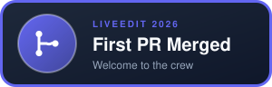
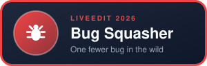
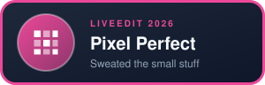
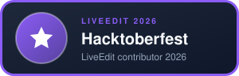

# Hacktoberfest 2026 Hall of Fame

Thank you to everyone who helped build LiveEdit this October. Every merged pull request earns a badge.

## The badges

| Badge | How to earn it |
| --- | --- |
|  | Get your first PR merged. Awarded automatically. |
|  | Add or improve tests (backend `pytest` or frontend Jest). |
|  | Fix a real bug. |
|  | Improve docs, guides or setup instructions. |
|  | Polish the UI: design, accessibility, empty/loading/error states. |
|  | Add or improve audio effects. |
|  | Any merged PR. Awarded automatically. |

When your PR is merged, a bot comments with your badges and a snippet to paste into your GitHub profile.

## Hall of Fame

Maintainers: add a row when you merge a contributor's PR.

| Contributor | Badges | PRs |
| --- | --- | --- |
| <!-- [@handle](https://github.com/handle) --> | | |

## Top contributors

<!-- Fill in at the end of the event. -->

1. 
2. 
3. 

## Everyone who helped

The full contributor list, including docs, design, testing and ideas, is in the [README](README.md#contributors).
